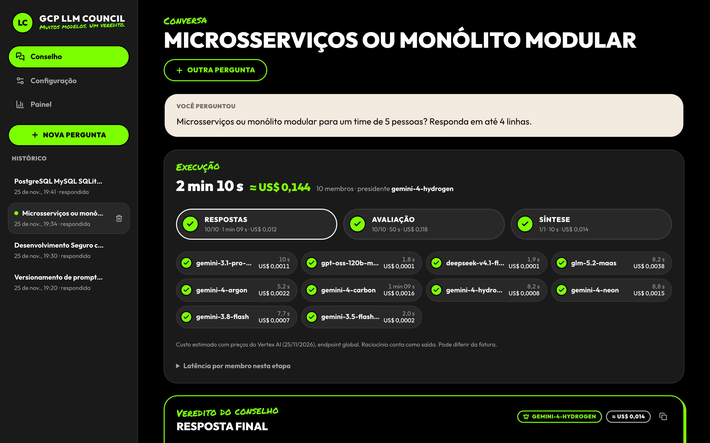
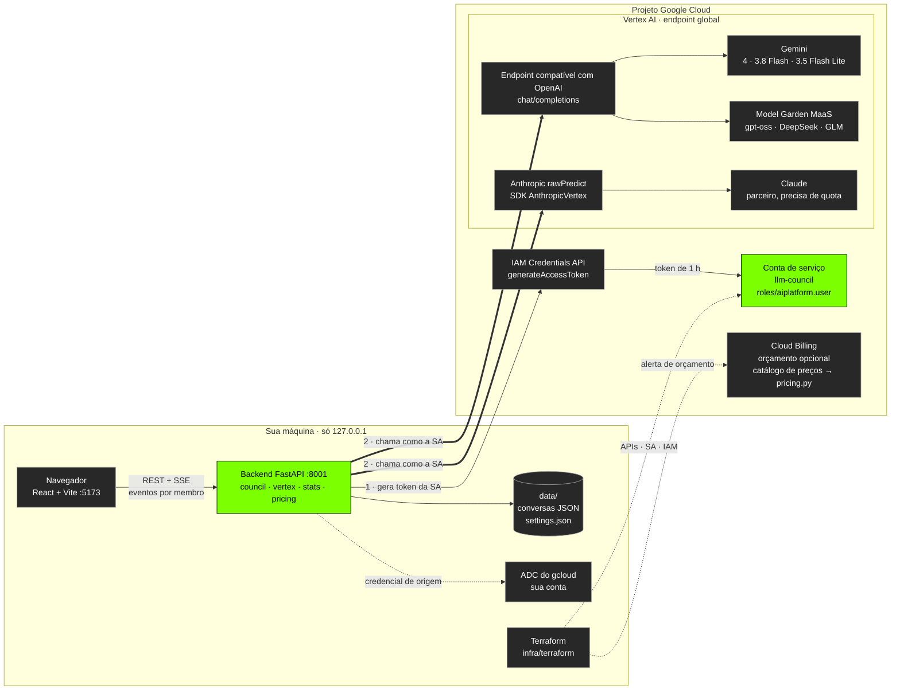
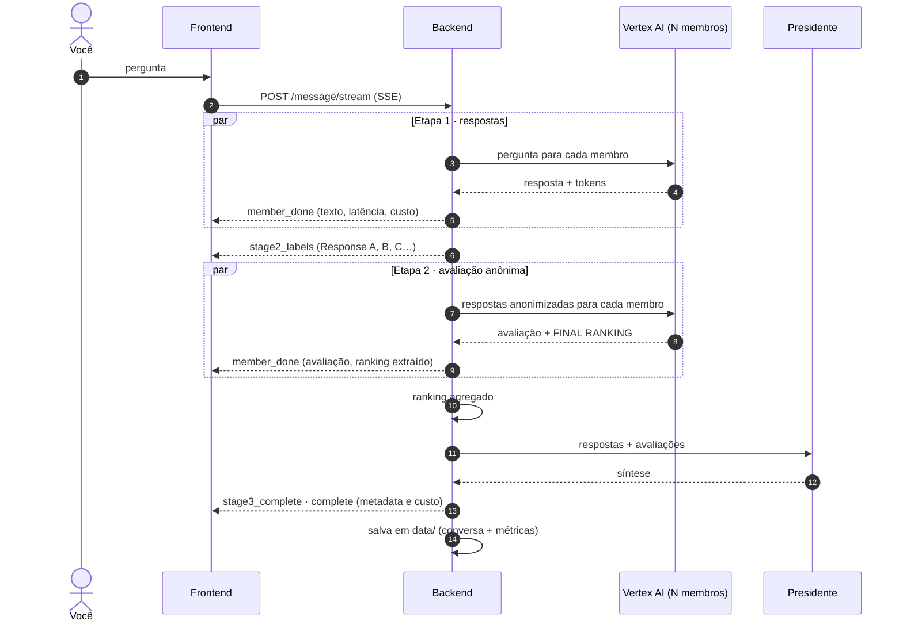

# GCP LLM Council

Faça uma pergunta a vários LLMs de uma vez, deixe que eles avaliem as respostas uns dos outros sem saber de quem são e receba uma síntese final, com todos os modelos rodando no **Google Cloud Vertex AI**.

> **Baseado no [karpathy/llm-council](https://github.com/karpathy/llm-council)**, de Andrej Karpathy, que criou a ideia e a primeira versão: um app local, parecido com o ChatGPT, em que um "conselho" de LLMs responde, revisa e sintetiza. Este projeto parte do commit [`92e1fcc`](https://github.com/karpathy/llm-council/commit/92e1fcc) e troca o OpenRouter pelo Vertex AI, reforça a segurança, redesenha a interface e acrescenta configuração, acompanhamento ao vivo e estimativa de custo.



## Como o conselho funciona

1. **Respostas.** A pergunta vai, em paralelo, para todos os membros do conselho. Cada um responde sozinho.
2. **Avaliação.** Cada membro recebe as respostas dos outros, anonimizadas como "Response A, B, C…", avalia cada uma e termina com um `FINAL RANKING:`. O app extrai esses rankings e calcula a posição média de cada modelo.
3. **Síntese.** Um modelo **presidente** recebe a pergunta, as respostas e as avaliações, e escreve a resposta final.

Cada pergunta faz cerca de `2 × membros + 2` chamadas: as respostas, as avaliações, a síntese e o título da conversa.

## Arquitetura no GCP



- **Tudo roda na sua máquina:** o navegador e o backend, ambos só em `127.0.0.1`. Conversas e configurações ficam em `data/`.
- **Credenciais:** o backend usa o seu ADC só para pedir à **IAM Credentials API** um token de 1 hora da **conta de serviço `llm-council`**. Todas as chamadas ao Vertex AI saem com essa identidade, que tem apenas `roles/aiplatform.user`.
- **Dois caminhos no Vertex AI:** Gemini e modelos MaaS do Model Garden usam o endpoint compatível com OpenAI; o Claude usa o `rawPredict` da Anthropic, pelo SDK oficial.
- **Terraform:** cria as APIs, a conta de serviço e as permissões, e opcionalmente um alerta de orçamento no **Cloud Billing**. A tabela de preços de `backend/pricing.py` foi tirada do catálogo do Cloud Billing; o app não o consulta em tempo de execução.

### Fluxo de uma pergunta



## O que muda em relação ao original

| | [karpathy/llm-council](https://github.com/karpathy/llm-council) | GCP LLM Council |
|---|---|---|
| Provedor | OpenRouter (chave de API) | **Vertex AI**, autenticado por ADC, sem chaves de API. Opcionalmente via **conta de serviço** com privilégio mínimo |
| Modelos | Lista fixa no código | Gemini, Claude e modelos do Model Garden (gpt-oss, DeepSeek, GLM…); configuráveis pela interface ou pelo `.env` |
| Acompanhamento | Indicador de carregamento por etapa | Status, latência, tokens e custo de **cada membro** ao vivo; respostas e avaliações aparecem **conforme ficam prontas** |
| Resultado | Abas por etapa e ranking agregado | Veredito, ranking agregado (*dot plot*), **matriz de quem votou em quem** (com autoavaliação destacada), respostas e avaliações completas |
| Configuração | Editar `config.py` | Tela para escolher membros, presidente e modelo de título, adicionar qualquer ID do Model Garden e **testar** cada modelo |
| Métricas | — | **Painel** com perguntas, duração, chamadas, falhas, tokens, **custo estimado** e desempenho por modelo |
| Segurança | App de exemplo, sem endurecimento | Servidor só local, proteção contra DNS rebinding, validação de entradas, limites de uso, markdown seguro (ver [Segurança](#segurança)) |
| Infra | — | **Terraform** para preparar qualquer projeto GCP |

## Funcionalidades

- **Conselho ao vivo:** cronômetro, etapas e status de cada membro (aguardando, rodando, ok, falhou). Clicar num membro abre a resposta dele, mesmo com os outros ainda trabalhando.
- **Veredito do presidente**, com botão de copiar.
- **Ranking agregado e matriz de avaliação**, que mostra o lugar que cada avaliador deu a cada resposta e sinaliza rankings que não puderam ser extraídos.
- **Custo estimado** por membro, por etapa e total, calculado a partir dos tokens de entrada, saída e **raciocínio**, com preços do catálogo do Google Cloud.
- **Configuração:** membros (2 a 12), presidente, modelo de título e teste de latência por modelo, com o preço de cada um.
- **Painel:** totais, posição média por modelo, últimas perguntas e uma tabela por modelo (vitórias, latência mediana, falhas, tokens, custo).
- Markdown com tabelas (GFM), layout responsivo e histórico com exclusão.

A interface está em português.

## Requisitos

- Um projeto no **Google Cloud** com faturamento ativo
- [`gcloud`](https://cloud.google.com/sdk/docs/install)
- [Terraform](https://developer.hashicorp.com/terraform/install) ≥ 1.5 (opcional, mas recomendado)
- Python ≥ 3.10 e [`uv`](https://docs.astral.sh/uv/)
- Node.js 20.19+ ou 22.12+ (exigência do Vite 7)

## Instalação

### 1. Preparar o projeto GCP

Com Terraform (habilita as APIs, cria a conta de serviço `llm-council` com `roles/aiplatform.user` e deixa você se passar por ela):

```bash
cd infra/terraform
cp terraform.tfvars.example terraform.tfvars   # defina project_id e impersonators
gcloud auth application-default login
terraform init && terraform apply
terraform output env_snippet                   # linhas prontas para o .env
```

Detalhes, permissões necessárias e o alerta de orçamento opcional estão em [Infraestrutura (Terraform)](#infraestrutura-terraform).

### 2. Habilitar os modelos de parceiros

Os modelos Gemini funcionam assim que a API está ativa. **Claude e os modelos abertos** (gpt-oss, DeepSeek, GLM, Qwen…) precisam ser habilitados **uma vez** no console, e não há recurso do Terraform para isso:

1. Abra *Vertex AI → Model Garden* no projeto.
2. Procure o modelo (por exemplo, "Claude Sonnet") e clique em **Enable**.
3. Aceite os termos. Alguns modelos pedem um formulário curto.

Antes disso, as chamadas retornam `404 Publisher model ... not found or your project does not have access to it`. Projetos novos também podem ter **quota zero** para o Claude (`429`); o aumento é pedido em *IAM e administrador → Cotas*.

### 3. Configurar e instalar

```bash
cp .env.example .env          # preencha GCP_PROJECT_ID e, de preferência, GCP_IMPERSONATE_SERVICE_ACCOUNT
uv sync
(cd frontend && npm install)
```

### 4. Rodar

```bash
./start.sh
```

Abra **http://localhost:5173**. O backend escuta em `127.0.0.1:8001`.

## Infraestrutura (Terraform)

`infra/terraform` prepara qualquer projeto GCP; nada nele depende de um projeto específico.

| Recurso | Para quê |
|---|---|
| APIs `aiplatform`, `iam`, `iamcredentials`, `serviceusage`, `cloudresourcemanager` | Vertex AI e impersonação. O `destroy` **não** desabilita as APIs |
| Conta de serviço `llm-council` com `roles/aiplatform.user` | Identidade do app, com privilégio mínimo |
| `roles/iam.serviceAccountTokenCreator` **só sobre essa conta**, para quem estiver em `impersonators` | Permite que você (e o app, com o seu ADC) gere tokens dela |
| `roles/aiplatform.user` para quem estiver em `vertex_users` | Opcional: pessoas usando as próprias credenciais |
| Orçamento mensal com alertas em 50%, 90% e 100% | Opcional (`enable_budget = true`, `billing_account`, `monthly_budget_amount`) |

**Permissões para aplicar:** Owner no projeto, ou o equivalente (Service Usage Admin, Service Account Admin e Project IAM Admin). Para o orçamento, também Billing Account Costs Manager.

**Projeto novo:** se o `plan` falhar com "Cloud Resource Manager API has not been used", habilite essa API uma vez antes, porque o Terraform precisa dela para ler o projeto:

```bash
gcloud services enable cloudresourcemanager.googleapis.com --project my-gcp-project
```

**Autenticação do app:**
- **Recomendado:** com seu usuário em `impersonators`, defina `GCP_IMPERSONATE_SERVICE_ACCOUNT` no `.env`. O backend usa o seu ADC só para gerar tokens de 1 h da conta de serviço. A permissão pode levar 1 a 2 minutos para propagar depois do `apply`.
- **Alternativa,** que vale para qualquer ferramenta que use ADC:
  ```bash
  gcloud auth application-default login --impersonate-service-account=llm-council@my-gcp-project.iam.gserviceaccount.com
  ```
- **Projeto de cota:** o arquivo de ADC pode ter um `quota_project_id` de **outro** projeto. O app sempre usa `GCP_PROJECT_ID` como projeto de cota. Para outras ferramentas, rode `gcloud auth application-default set-quota-project my-gcp-project`.

**Estado:** `terraform.tfstate` e `terraform.tfvars` ficam locais e fora do git, porque contêm IDs e e-mails. O `.terraform.lock.hcl` é versionado. Para uso em equipe, configure um backend remoto (por exemplo, um bucket GCS) num `backend.tf`.

**Remover:** `terraform destroy` apaga a conta de serviço, as permissões e o orçamento, mas mantém as APIs habilitadas.

## Configuração (`.env`)

| Variável | Padrão | Para quê |
|---|---|---|
| `GCP_PROJECT_ID` | — | Projeto com o Vertex AI habilitado (**obrigatória**) |
| `GCP_LOCATION` | `global` | Região padrão. Vários modelos MaaS só existem no endpoint `global` |
| `GCP_IMPERSONATE_SERVICE_ACCOUNT` | — | Chamar o Vertex como esta conta de serviço (recomendado) |
| `COUNCIL_MODELS` | ver `backend/config.py` | Membros, separados por vírgula, no formato `publisher/modelo[@região]` |
| `CHAIRMAN_MODEL` | `google/gemini-4-hydrogen` | Presidente (síntese) |
| `TITLE_MODEL` | `google/gemini-3.8-flash` | Modelo que dá título às conversas |
| `MODEL_TIMEOUT_SECONDS` | `600` | Timeout por chamada (a etapa de avaliação é a mais lenta) |
| `MAX_MESSAGE_CHARS` | `20000` | Tamanho máximo da pergunta |
| `MAX_MESSAGES_PER_MINUTE` | `5` | Perguntas por minuto |
| `MAX_MODEL_TESTS_PER_MINUTE` | `20` | Testes de modelo por minuto (tela de Configuração) |
| `PRICING_OVERRIDES` | — | JSON `{"publisher/modelo": [entrada, saída]}` em US$ por 1M de tokens |

O que for salvo pela tela de Configuração vai para `data/settings.json` e tem prioridade sobre o `.env`. O botão **Padrão** volta aos valores do `.env`.

### Formato dos modelos

- `anthropic/...` é chamado pelo SDK oficial da Anthropic (`AsyncAnthropicVertex`).
- Todo o resto (Gemini e modelos MaaS) passa pelo endpoint compatível com OpenAI do Vertex AI.
- O sufixo `@região` troca a região de um modelo, por exemplo `openai/gpt-oss-120b-maas@us-central1`.

## Custos

As estimativas usam `backend/pricing.py`, uma tabela em US$ por 1M de tokens tirada da **Cloud Billing Catalog API** (endpoint global, predição online, contexto de até 200 mil tokens). A data da consulta está no arquivo.

- **Tokens de raciocínio** são cobrados como saída. O Gemini os informa separados (`reasoning_tokens`); os modelos MaaS e o Claude os incluem na saída.
- São **estimativas**: a fatura real depende de região, faixa de contexto, cache e descontos. Modelos fora da tabela aparecem como "sem preço".
- A **etapa de avaliação** costuma ser a mais cara, porque cada membro relê todas as respostas.
- Vale ligar o **alerta de orçamento** no Terraform (`enable_budget = true`).

## Segurança

O app foi feito para rodar **só na sua máquina**.

- Servidor ligado em `127.0.0.1`, `TrustedHostMiddleware` (contra DNS rebinding) e CORS restrito a localhost.
- IDs de conversa validados como UUID; IDs de modelo validados por regex antes de virar URL ou região, então o token do Google só vai para `*.aiplatform.googleapis.com`.
- Limite de tamanho e de frequência nas rotas pagas; mensagens de erro genéricas para o cliente.
- Markdown sem HTML cru e **sem carregar imagens** (elas viram links), o que evita vazamento por URL de imagem.
- Conversas e configurações em `data/` com permissões 0700/0600, fora do git.
- Sem chaves de API: autenticação por ADC, de preferência impersonando a conta de serviço.

Limitações conhecidas:
- a API local **não tem autenticação** (qualquer processo da máquina pode usá-la);
- não há teto de tokens de saída por chamada nem limite de custo por pergunta;
- membros podem tentar influenciar a avaliação uns dos outros por **injeção de prompt** (é inerente ao método);
- cada pergunta é enviada a todos os modelos do conselho, então evite dados sensíveis.

## Estrutura

```
README.md        este arquivo
CLAUDE.md        notas técnicas do código
.env.example     modelo de configuração
start.sh         sobe backend e frontend
backend/
  main.py        API FastAPI, limites, streaming de eventos (SSE)
  council.py     as 3 etapas, eventos por membro, custo por etapa
  vertex.py      cliente Vertex AI (SDK Anthropic + endpoint compatível com OpenAI), ADC/impersonação
  settings.py    configuração do conselho editável pela interface + catálogo de modelos
  pricing.py     tabela de preços e estimativa de custo
  stats.py       métricas do painel
  storage.py     conversas em JSON
  config.py      variáveis de ambiente e padrões
frontend/src/
  App.jsx                  estado e eventos ao vivo
  components/              ChatView, RunView, SettingsView, DashboardView, Sidebar, charts, SafeMarkdown
  ui/, styles/tokens.css   componentes e tokens visuais
  lib/                     formatação e custo
infra/terraform/           APIs, conta de serviço, IAM, orçamento opcional
```

Notas técnicas para quem for mexer no código: [`CLAUDE.md`](CLAUDE.md).

## Desenvolvimento

```bash
cd frontend && npm run lint && npm run build
```

Não há suíte de testes automatizados. Para validar uma mudança, rode o app e faça uma pergunta, lembrando que isso gera chamadas pagas.

## Créditos e licença

- Ideia, método das 3 etapas e código de partida: **[karpathy/llm-council](https://github.com/karpathy/llm-council)**, de Andrej Karpathy.
- Tokens visuais (cores, espaçamento, raios) inspirados num design system pessoal. As fontes são livres: [Outfit](https://fonts.google.com/specimen/Outfit) (OFL) e [Permanent Marker](https://fonts.google.com/specimen/Permanent+Marker) (Apache 2.0). Ícones: [Lucide](https://lucide.dev).

**Licença:** o repositório original **não declara licença**. Antes de redistribuir este fork, confirme os termos de uso do código original.
